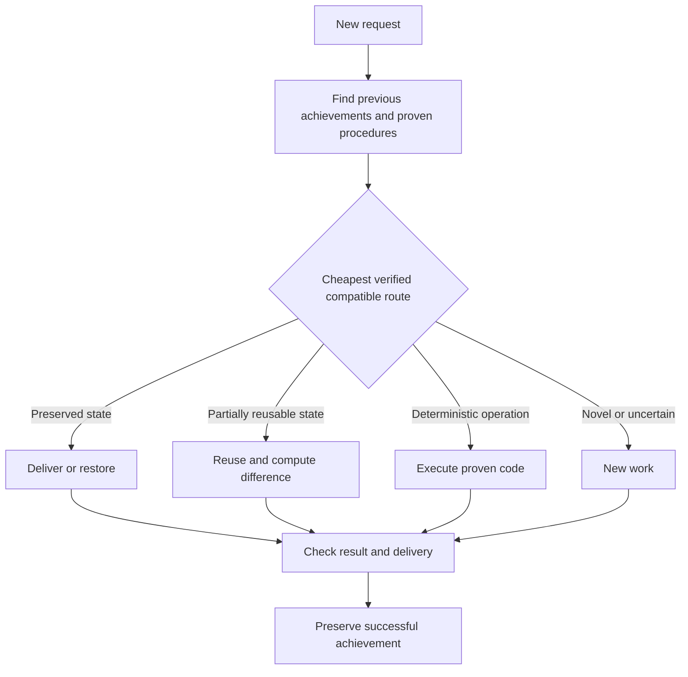

# ECOmpile

A model figures something out.

Then, next time, we make the model figure out the same thing again. And again. And again.

ECOmpile is my attempt to stop doing that by preserving what was achieved, and by turning repeatable supporting operations into ordinary code where that's cheaper.

**Never repeat an achievement unnecessarily.**

A finished result or working state can become the next task's starting point—or be delivered directly. When storing every result is less useful than repeating a small, reliable operation, that operation can become deterministic, inspectable, testable code. Neural processing remains for what still requires new work.

## The two roles

**1. Achieved states: the macro elements.** ECOmpile preserves a successful output or a recoverable working state, with the relevant inputs, conditions, evidence and means of delivering it again. When a new request matches, the achievement can be reused directly. When only part matches, retain the applicable part and calculate the difference.

**2. Deterministic code: the supporting process.** Stable successful actions become scripts, functions or compiled routines when repeated execution is cheaper than retaining and retrieving separate outputs. The program can also produce a new achievement worth preserving.

These routes are complementary, but they are not equally necessary for every task. A result may be worth keeping without extracting an algorithm. A tiny deterministic procedure may be better executed than storing thousands of resulting states. ECOmpile chooses by the total cost of a correctly delivered outcome.

For an exact, verified match, state delivery can avoid virtually all repeated neural inference. Lookup, storage, reconstruction and verification still cost something. Identical bytes can be delivered reliably; applicability under changed conditions must be established separately.

The first experiments should compare normal inference, direct state reuse, partial-state adaptation, and deterministic execution, measuring delivery reliability and total cost. The existing repository primarily implements the deterministic-kernel direction; general result-state preservation and delivery remain proposed.

[Full definition and first experiment: Never-repeat principle](docs/never_repeat_principle.md).

## What exists right now

This is R&D. It is not a finished self-compiling AI platform.

The repo already contains:

- architecture and roadmap material
- a concrete case -> kernel seed
- a kernel index
- routing logic
- early SDK examples
- benchmark scaffolding
- provenance and handoff material
- governance / risk material

Current stage: **R&D prototype / bounded proof seeds**.

There is enough here to show the mechanism and build experiments around it. There is not enough here to claim the big system has already been proven.

## The useful next proof

Take an expensive task with a verified successful output. Repeat it by retrieving the achieved state, then change one input and reuse only what remains applicable. Separately turn a recurring cheap sub-operation into deterministic code. Compare all three with fresh neural execution.

Measure delivery correctness, false matches, runtime, total cost, computation avoided, and how often each method wins. The first exact-match tests should establish actual reliability rather than assuming it.

## Where to look

- [Overview](docs/overview.md)
- [Architecture](docs/architecture.md)
- [Never-repeat principle: achieved states and deterministic support](docs/never_repeat_principle.md)
- [Roadmap](docs/roadmap.md)
- [Governance](docs/governance.md)
- [Artifact harvester spec](docs/artifact_harvester_spec.md)
- [Public release dossier](docs/public_release.md)
- [Case material](cases/)
- [Compiled kernels](kernels/)
- [Routing model](engine-concept/kernel-routing.md)
- [SDK examples](sdk/examples/)

The repo also keeps the boundary explicit: true model-internal introspection needs host-runtime telemetry. What exists here works from observable behavior, traces and artifacts available outside the model internals.

## Why I am showing this publicly

Because I want people who actually run models, build AI infrastructure, benchmark systems, care about reliability, or care about energy use to look at the mechanism and tell me where it survives reality and where it does not.

If you can help test it, fund it, expose it to real workloads, or provide the runtime access needed for deeper experiments, I am interested.

## License / authorship

Primary license: [LICENSE-APC.md](LICENSE-APC.md)

Authorship/provenance material:

- [IPCONFIG_PROOF.md](docs/legal/IPCONFIG_PROOF.md)
- [IP_PROVENANCE_REGISTER.md](docs/legal/IP_PROVENANCE_REGISTER.md)

Contact: stojnic.slavko@gmail.com

[Support the work](https://ko-fi.com/earthcraft)

## Better implementations

The purpose of this project matters more than its current design. Its architecture and methods are examples of how to achieve that purpose, not permanent limits. A better approach can replace any part or all of the implementation when it produces a better result. Document new methods as they are developed; preserve the original publication history.

[Principle shared by all projects](https://github.com/aRcHmaGe333/aRcHmaGe333/blob/main/UNIVERSAL_IMPLEMENTATION_PRINCIPLES.md)
