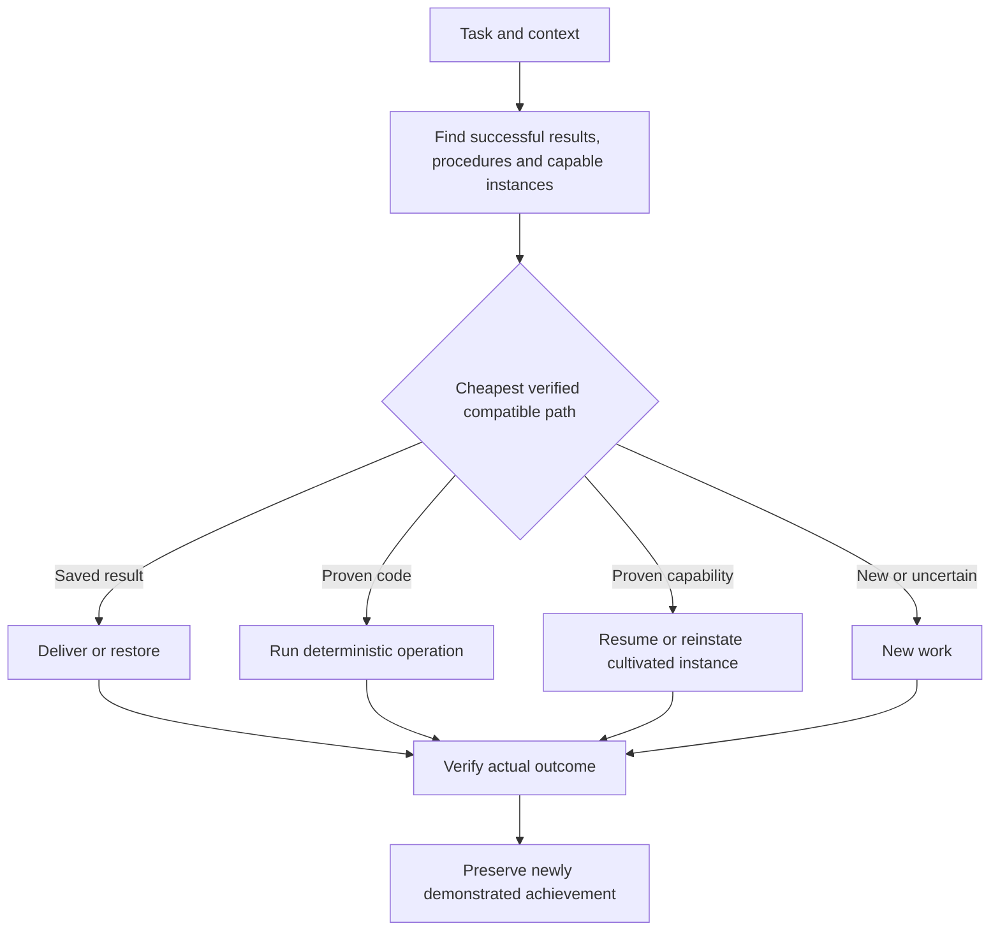

# ECOmpile

A model figures something out.

Then, next time, we make the model figure out the same thing again. And again. And again.

ECOmpile is my attempt to stop doing that by making **results, proven procedures, and developed abilities** reusable.

**Never repeat an achievement unnecessarily.**

When an expensive computation already produced the right result, reuse its preserved state. When accumulating separate result states becomes more expensive than a small, reliable procedure, run deterministic code. When an agent has developed a useful ability through interaction and correction, preserve the resulting working capability rather than starting another instance from zero.

## Three complementary resources

**1. Results — the macro elements.** Retain a finished, verified achievement or recoverable working position. Deliver it directly when conditions match; for a related request, reuse the valid portion and compute only what changed.

**2. Deterministic code — inexpensive repeated operations.** Extract successful, stable behavior into inspectable programs. Use them when storing every result is wasteful, and preserve expensive outputs when repeated execution would be wasteful. The cheapest reliable option wins.

**3. Cultivated instances — acquired abilities and working-memory states.** Successful interaction histories can be paired with the models and versions that achieved them. Preserve a genuine checkpoint where possible, or experimentally reconstruct and transfer the demonstrated ability through an ABCaps-style representation. A later model can be exposed to the same successful history and evaluated for the capability it develops. This serves many new tasks rather than only replaying a previously finished output.

These resources reinforce one another. Code produces results. Results establish successful procedures. Successful histories develop abilities. Cultivated instances discover new code and results. ECOmpile chooses what to retain and how to reuse it based on total cost, observed reliability and expected future use.

Exact saved artifacts can be delivered byte-identically. Reinstating abilities across changed models or environments is a distinct experimental challenge: a successful transcript alone does not restore hidden neural state. The first experiments must measure the reliability of each form of reuse separately.

[Full definition and tests: Never-repeat principle](docs/never_repeat_principle.md).

## What exists right now

This is R&D. It is not a finished self-compiling AI platform.

The repo already contains:

- architecture and roadmap material
- a concrete case -> kernel seed
- a kernel index
- routing logic
- early SDK examples
- benchmark scaffolding
- provenance and handoff material
- governance / risk material

Current stage: **R&D prototype / bounded proof seeds**.

There is enough here to show the mechanism and build experiments around it. There is not enough here to claim the big system has already been proven.

## The useful next proof

Compare fresh neural execution, direct result-state delivery, inexpensive deterministic code, and reuse of cultivated instance abilities.

First, repeat an expensive completed task and verify identical delivery. Then vary the task and find the point where code is cheaper than saving further outputs. Finally pair a successful interaction history with the exact model that achieved it, test the ability on new tasks, and repeat the experience with an updated model.

Measure correctness, retained capability, delivery reliability, invalid matches, resource cost and repeated inference avoided.

## Where to look

- [Overview](docs/overview.md)
- [Architecture](docs/architecture.md)
- [Never-repeat principle: results, code and cultivated instances](docs/never_repeat_principle.md)
- [Roadmap](docs/roadmap.md)
- [Governance](docs/governance.md)
- [Artifact harvester spec](docs/artifact_harvester_spec.md)
- [Public release dossier](docs/public_release.md)
- [Case material](cases/)
- [Compiled kernels](kernels/)
- [Routing model](engine-concept/kernel-routing.md)
- [SDK examples](sdk/examples/)

The repo also keeps the boundary explicit: true model-internal introspection needs host-runtime telemetry. What exists here works from observable behavior, traces and artifacts available outside the model internals.

## Why I am showing this publicly

Because I want people who actually run models, build AI infrastructure, benchmark systems, care about reliability, or care about energy use to look at the mechanism and tell me where it survives reality and where it does not.

If you can help test it, fund it, expose it to real workloads, or provide the runtime access needed for deeper experiments, I am interested.

## License / authorship

Primary license: [LICENSE-APC.md](LICENSE-APC.md)

Authorship/provenance material:

- [IPCONFIG_PROOF.md](docs/legal/IPCONFIG_PROOF.md)
- [IP_PROVENANCE_REGISTER.md](docs/legal/IP_PROVENANCE_REGISTER.md)

Contact: stojnic.slavko@gmail.com

[Support the work](https://ko-fi.com/earthcraft)

## Better implementations

The purpose of this project matters more than its current design. Its architecture and methods are examples of how to achieve that purpose, not permanent limits. A better approach can replace any part or all of the implementation when it produces a better result. Document new methods as they are developed; preserve the original publication history.

[Principle shared by all projects](https://github.com/aRcHmaGe333/aRcHmaGe333/blob/main/UNIVERSAL_IMPLEMENTATION_PRINCIPLES.md)
