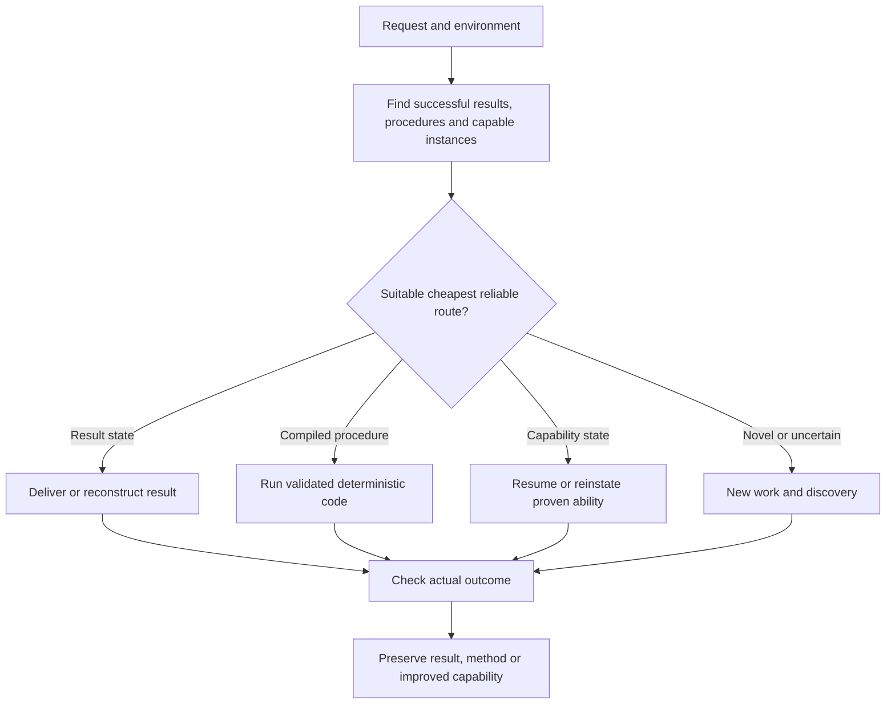

# Never-repeat principle — achievement-first ECOmpile

## Central idea

An AI system reaches a successful result. The next equivalent request should begin from **that achievement**, not from the original unsolved problem.

ECOmpile has **three complementary forms of reuse**:

**1. Achieved results (macro states).** Preserve the complete successful outcome, or a recoverable state sufficient to produce it. When the current request matches, deliver it or reinstate it. The previously expensive computation becomes inexpensive retrieval.

**2. Deterministic procedures (supporting code).** Preserve a general method rather than many separate outcomes when inexpensive, validated code produces them more economically. The previously expensive repeated neural path becomes inexpensive execution. Sometimes storing the output is cheaper than rerunning the code; sometimes retaining thousands of outputs is costlier than one working procedure. ECOmpile can choose either.

**3. Cultivated instances (capability states).** Preserve an instance's demonstrated abilities and relevant working-memory state, with the model, runtime and successful learning/work history that produced them. This is the ABCaps direction: reuse an ability achieved through extensive interaction, not merely an isolated answer. Where the platform permits, resume a genuine checkpoint; otherwise use a proven portable capability representation and measure what the receiving instance can actually do.

**Never-repeat** concerns the expensive *acquisition of the achievement*. Reusing it might mean delivering a result, running code, or resuming a capable instance. The three resources can generate and improve one another. ECOmpile chooses a compatible route based on both delivery cost and the expected value of future reuse.

**Never repeat an achievement unnecessarily.**

## What counts as a state

The word *state* includes several different kinds of achievement. Preserve only what is needed to make the result available again:

- **Completed result:** an output artifact, finished analysis, code change, rendered media, calculation, or other deliverable.
- **Recoverable working position:** verified inputs, checkpoints, dependencies, tools, and execution position sufficient to continue or restore work.
- **Verified environment:** a software or machine configuration known to produce a required outcome.
- **Established capability:** an instance's verified abilities, working-memory state, and operational conditions, with evidence from the interactions in which they succeeded. ABCaps seeks to preserve and reinstate such capabilities, where a receiving runtime supports it.

Sometimes the payload is a set of bytes. Sometimes it is a tiny manifest referring to content already stored through UDF. Sometimes it is a checkpoint or a reproducible environment. The descriptor may be compact even when the logical achievement is large. A summary or set of instructions alone is not automatically equivalent to a restorable state.

ECOmpile records what was **actually achieved**, the circumstances of success, and how it can be delivered again. A plausible answer is not sufficient evidence of success.

## Three routes and their selection

Exact-result, partial-result and capability reuse may all include small adaptations. Cost comparison includes preparation and delivery, not just execution. A cultivated instance is especially valuable when many *different* future tasks require the same hard-won ability rather than an identical stored result.

### When state wins

The requested result already exists, the relevant inputs and conditions match, and retrieval or restoration is cheaper than rerunning the work. Deliver it from its original immutable content or restore its verified checkpoint. A content hash can establish byte identity; suitability depends on the outcome and its validity conditions.

Example: an expensive audio render has already been produced and confirmed, with unchanged source material and settings. Return the same output, not a new render.

### When code wins

The operation is stable, inexpensive in ordinary code, and produces many different results from changing inputs. Retaining a separate complete state for each possible input would cost more than invoking the same proven program.

Example: a validated conversion, parser, normalization function, or calculation is inexpensive to execute. Use the program rather than a model or a growing archive of every possible output.

### When both win

Persist reusable macro states and execute inexpensive supporting code only for the parts that differ. A successful operation may be worth retaining after the fact if it is expensive or likely to recur.

Example: a previously completed software repair includes a verified configuration. A small deterministic adjustment adapts that configuration to a compatible machine; the new successful configuration is preserved for future reuse.

### When a cultivated instance wins

A model has acquired abilities through examples, exploration, corrections and successful work that would be expensive to repeat for each new request. A verified instance state (including working memory when available) can serve many related but nonidentical tasks. This is **capability reuse**, distinct from delivering a previously solved task's result.

Example: an agent has been guided through difficult audio alignment cases and now reliably performs a class of alignment work. Preserve the achieved operating ability, not merely the last aligned file. Resume it for new audio, and measure whether it retains the demonstrated competence.

### When fresh work wins

Relevant conditions have changed, compatibility cannot be established, the needed result does not exist, or the cost of validating a reuse candidate exceeds direct execution. Solve the task normally, test its outcome, and consider preserving what genuinely worked.

## Successful logs, models, and cultivated instances

A successful interaction history is not only documentation. It is evidence about **which model achieved which abilities under which conditions**. The log should be paired with the model identity, version, runtime settings, available tools, corrections, evaluations and resulting working-memory or recoverable execution state.

A log can be used in three ways:

1. **Reinstate:** resume the original instance's checkpoint when the runtime actually supports this; otherwise provide a compatible ABCaps representation, then demonstrate retained ability on new tasks.
2. **Reproduce:** run the established interaction or training sequence against the same model and compare resulting abilities and outputs. This is a reconstruction experiment, not guaranteed replay of hidden model state.
3. **Transfer or improve:** expose an updated or different model to the successful history, observe the state and ability it develops, and compare against both the original instance and the new model without that history. New model versions may require less teaching, respond differently, or regress.

The valuable record is a **model–experience–capability pairing**, not just a transcript:

| Part | What it establishes |
| --- | --- |
| Model and runtime | Exact model ID/version where known, settings, tools, environment |
| Interaction history | Task, decisions, demonstrations, corrections, successful turns, source references |
| Observed achievements | Finished outputs, quality checks, and measurable ability on new tasks |
| Working-memory state | Actual checkpoint, tool state, accessible session state, or ABCaps-compatible representation; record which is real |
| Transfer evidence | Recipient model/version, restoration or conditioning method, repeated task results and limitations |

Retain successful paths and the corrections that made them work. When a better model can achieve the same ability with fewer steps, the shorter successful path becomes a new reusable resource. When combining two cultivated instances improves performance, record both source histories and the tested combined result.

A prior log can influence a new model without restoring the original model's private hidden activations. ECOmpile should distinguish **faithful checkpoint restoration**, **reconstruction from experience**, and **behavioral transfer verified by tests**. Their costs and guarantees differ.

This is where ABCaps fits most naturally: **the resource is an acquired ability**, with the successful working state that made it possible—not a single finished file, and not simply a textual description of how to behave.

## Cost model

Evaluate **total cost of a correct delivered outcome**, not model inference alone:

`C(state) = lookup + storage share + retrieval + reconstruction + verification + expected invalidation cost`

`C(code) = lookup + execution + verification + amortized implementation/maintenance cost`

`C(capability) = lookup + state load or reconstruction + continued execution + verification + expected adaptation cost`

`C(neural) = inference + tools + verification + expected correction/retry cost`

The system should choose the lowest expected cost among **routes known to satisfy the current conditions**. If the reliability evidence differs, evaluate risk as well as cost. The value of preserving a newly completed state depends on its size, reuse likelihood, retention duration, reconstructability, and potential future savings. A cultivated capability may cost more to store/load than one result, yet pay off over many distinct future tasks.

"Virtually no cost" refers to **avoiding expensive repeated neural work** on a validated reuse path. Lookup, bytes, execution, integrity checks, and delivery still have measurable costs.

## Delivery reliability

Replaying immutable verified bytes under an exact-match contract should be highly reliable. That is different from establishing that the bytes still answer the user's current request.

Three separate questions must be tested:

1. **Integrity:** Is this precisely the saved artifact or recorded state?
2. **Applicability:** Do the requested outcome and relevant conditions match the successful case?
3. **Delivery:** Did the right result actually reach the intended destination without unintended side effects?

Deterministic scripts can produce identical outputs for identical inputs under their specified environment and dependencies. Those guarantees do not automatically extend to changing external services, hidden state, nondeterminism, or mismatched execution environments.

The aim is **reliable delivery by design**, with confidence demonstrated in tests. Universal infallibility is not a premise.

## First experiment

Choose one completed, expensive task whose input and output can be inspected exactly.

1. Run it normally; retain the successful output, relevant inputs, environment description, and measured cost.
2. Repeat the identical request by delivering the retained achievement; compare content, relevance, latency, total resource cost, and delivery success.
3. Change one meaningful input; reuse the valid part of the previous state, perform only the necessary work, and compare the result with a fresh execution.
4. Implement one recurring sub-operation as ordinary deterministic code; compare repeated execution with both neural inference and storing many separate results.
5. Pair a successful interaction history with the exact model/version that produced it. Test a genuine restored checkpoint when available, then a reconstructed or ABCaps-conditioned instance on *new* tasks requiring the same ability.
6. Repeat the successful history with an updated model; measure whether the acquired capability is retained, improved, or lost compared with both the original model and the updated model's own baseline.
7. Repeat the cases across controlled variations to expose false matches, stale states, unexpected side effects, and the actual cost crossover.

The first tests should distinguish reliability **of exact state delivery** from reliability **of matching or adapting a state**. A high success rate in the first does not prove the others.

## Relation to existing ECOmpile and ASOSOS work

- **Existing ECOmpile:** kernels and routing based on successful actions are a beginning for the deterministic-code route.
- **ECOmpile V2:** ingestion, outcome extraction, convergence mining, explicit activation decisions, and deterministic templates offer components to reuse. The repository does not yet demonstrate a general persistent achievement-state registry, exact-match state delivery, checkpoint restoration, or the comparative experiments above.
- **UDF:** may supply content-addressed storage, manifests, retrieval and on-demand materialization without retaining multiple physical copies.
- **ABCaps:** concerns cultivated instance abilities and their working-memory states, distinct from single finished results. Portable capability transfer remains subject to demonstration on each receiving model/runtime.
- **ASOSOS:** can use ECOmpile to reuse achievements across other systems, not just to optimize individual AI prompts.

The larger invention is not a model that merely remembers the answer. It is a system in which **a result already earned becomes directly available; a repeated operation becomes cheap code; and an ability already developed can become the next instance's starting capability**.
