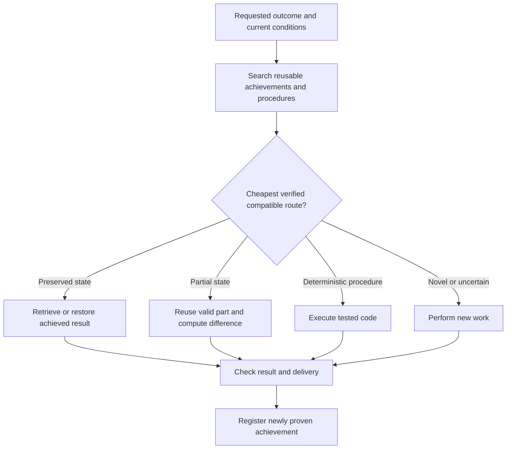

# Never-repeat principle — achievement-first ECOmpile

## Central idea

An AI system reaches a successful result. The next equivalent request should begin from **that achievement**, not from the original unsolved problem.

ECOmpile has two complementary forms of reuse, with an important distinction in scale:

**The macro element is the achieved state.** The complete verified result, or a recoverable working state that can reliably produce that result, becomes a resource. Where the new request matches its relevant conditions, ECOmpile delivers or reinstates it, avoiding the original inference and work.

**The supporting element is deterministic execution.** When there is no useful reason to retain a distinct full result state for every execution, ECOmpile identifies stable behavior that can be implemented as a script, function, or other tested program. The program reproduces the relevant operation more cheaply and consistently than repeated neural inference, within its verified range.

These are not two equally mandatory pipelines. The system chooses the least expensive reliable way to meet the requested outcome, and a compiled operation may itself produce a state worth preserving.

**Never repeat an achievement unnecessarily.**

## What counts as a state

The word *state* includes several different kinds of achievement. Preserve only what is needed to make the result available again:

- **Completed result:** an output artifact, finished analysis, code change, rendered media, calculation, or other deliverable.
- **Recoverable working position:** verified inputs, checkpoints, dependencies, tools, and execution position sufficient to continue or restore work.
- **Verified environment:** a software or machine configuration known to produce a required outcome.
- **Established capability:** a reliably reproducible way of working, possibly transferable through ABCaps where a receiving runtime supports faithful reinstatement.

Sometimes the payload is a set of bytes. Sometimes it is a tiny manifest referring to content already stored through UDF. Sometimes it is a checkpoint or a reproducible environment. The descriptor may be compact even when the logical achievement is large. A summary or set of instructions alone is not automatically equivalent to a restorable state.

ECOmpile records what was **actually achieved**, the circumstances of success, and how it can be delivered again. A plausible answer is not sufficient evidence of success.

## The two routes and their selection

### When state wins

The requested result already exists, the relevant inputs and conditions match, and retrieval or restoration is cheaper than rerunning the work. Deliver it from its original immutable content or restore its verified checkpoint. A content hash can establish byte identity; suitability depends on the outcome and its validity conditions.

Example: an expensive audio render has already been produced and confirmed, with unchanged source material and settings. Return the same output, not a new render.

### When code wins

The operation is stable, inexpensive in ordinary code, and produces many different results from changing inputs. Retaining a separate complete state for each possible input would cost more than invoking the same proven program.

Example: a validated conversion, parser, normalization function, or calculation is inexpensive to execute. Use the program rather than a model or a growing archive of every possible output.

### When both win

Persist reusable macro states and execute inexpensive supporting code only for the parts that differ. A successful operation may be worth retaining after the fact if it is expensive or likely to recur.

Example: a previously completed software repair includes a verified configuration. A small deterministic adjustment adapts that configuration to a compatible machine; the new successful configuration is preserved for future reuse.

### When fresh work wins

Relevant conditions have changed, compatibility cannot be established, the needed result does not exist, or the cost of validating a reuse candidate exceeds direct execution. Solve the task normally, test its outcome, and consider preserving what genuinely worked.

## Cost model

Evaluate **total cost of a correct delivered outcome**, not model inference alone:

`C(state) = lookup + storage share + retrieval + reconstruction + verification + expected invalidation cost`

`C(code) = lookup + execution + verification + amortized implementation/maintenance cost`

`C(neural) = inference + tools + verification + expected correction/retry cost`

The system should choose the lowest expected cost among **routes known to satisfy the current conditions**. If the reliability evidence differs, evaluate risk as well as cost. The value of preserving a newly completed state depends on its size, reuse likelihood, retention duration, reconstructability, and potential future savings.

"Virtually no cost" refers to **avoiding expensive repeated neural work** on a validated reuse path. Lookup, bytes, execution, integrity checks, and delivery still have measurable costs.

## Delivery reliability

Replaying immutable verified bytes under an exact-match contract should be highly reliable. That is different from establishing that the bytes still answer the user's current request.

Three separate questions must be tested:

1. **Integrity:** Is this precisely the saved artifact or recorded state?
2. **Applicability:** Do the requested outcome and relevant conditions match the successful case?
3. **Delivery:** Did the right result actually reach the intended destination without unintended side effects?

Deterministic scripts can produce identical outputs for identical inputs under their specified environment and dependencies. Those guarantees do not automatically extend to changing external services, hidden state, nondeterminism, or mismatched execution environments.

The aim is **reliable delivery by design**, with confidence demonstrated in tests. Universal infallibility is not a premise.

## First experiment

Choose one completed, expensive task whose input and output can be inspected exactly.

1. Run it normally; retain the successful output, relevant inputs, environment description, and measured cost.
2. Repeat the identical request by delivering the retained achievement; compare content, relevance, latency, total resource cost, and delivery success.
3. Change one meaningful input; reuse the valid part of the previous state, perform only the necessary work, and compare the result with a fresh execution.
4. Implement one recurring sub-operation as ordinary deterministic code; compare repeated execution with both neural inference and storing many separate results.
5. Repeat the cases across controlled variations to expose false matches, stale states, unexpected side effects, and the actual cost crossover.

The first tests should distinguish reliability **of exact state delivery** from reliability **of matching or adapting a state**. A high success rate in the first does not prove the others.

## Relation to existing ECOmpile and ASOSOS work

- **Existing ECOmpile:** kernels and routing based on successful actions are a beginning for the deterministic-code route.
- **ECOmpile V2:** ingestion, outcome extraction, convergence mining, explicit activation decisions, and deterministic templates offer components to reuse. The repository does not yet demonstrate a general persistent achievement-state registry, exact-match state delivery, checkpoint restoration, or the comparative experiments above.
- **UDF:** may supply content-addressed storage, manifests, retrieval and on-demand materialization without retaining multiple physical copies.
- **ABCaps:** may supply portable working capabilities where transfer has been demonstrated.
- **ASOSOS:** can use ECOmpile to reuse achievements across other systems, not just to optimize individual AI prompts.

The larger invention is not a model that merely remembers the answer. It is a system in which **a result already earned can become the next task's starting position, or the result itself**.
